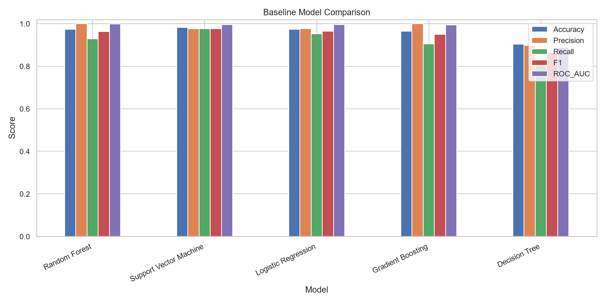

# Breast Cancer Classification Using Machine Learning

Comparative performance analysis of machine learning models for breast cancer classification, with EDA, hyperparameter tuning and a Streamlit demo.

**Institution:** Ramdeobaba University
**Branch:** B.Tech, Robotics and AI
**Team:** Utkarsh Mall, Faiz Sheikh, Soham Sahana
**Guide:** Ayesha Khan
**Dataset:** Breast Cancer Wisconsin (Diagnostic), UCI Machine Learning Repository
**Task:** Binary classification (benign = 0, malignant = 1)

> **Important:** This project is for education only. It is not a medical device or diagnostic service and must not be used for healthcare decisions.

## Results (held-out test set, `random_state=42`)

| Model | Accuracy | Precision | Recall | F1 | ROC-AUC |
|---|---|---|---|---|---|
| Logistic Regression | 97.37% | 97.56% | 95.24% | 96.39% | 99.54% |
| Decision Tree | 90.35% | 89.74% | 83.33% | 86.42% | 88.89% |
| Random Forest | 97.37% | 100.00% | 92.86% | 96.30% | 99.80% |
| Support Vector Machine | 98.25% | 97.62% | 97.62% | 97.62% | 99.54% |
| Gradient Boosting | 96.49% | 100.00% | 90.48% | 95.00% | 99.47% |
| Tuned Random Forest | 97.37% | 100.00% | 92.86% | 96.30% | 99.67% |

SVM has the best accuracy, recall and F1. Random Forest has the best ROC-AUC, and the tuned Random Forest is the model saved for the Streamlit app. Results come from a single split; see the report for limitations.



## Dataset

- Source: https://archive.ics.uci.edu/dataset/17/breast+cancer+wisconsin+diagnostic
- 569 samples, 30 numerical features, 357 benign and 212 malignant.
- Loaded through `sklearn.datasets.load_breast_cancer` (public copy of the UCI data), so no manual download is needed.

## Project structure

```text
breast-cancer-ml-classification/
├── app.py              # Streamlit app
├── train.py            # EDA, training, tuning, evaluation
├── src_utils.py        # shared helpers
├── requirements.txt
├── artifacts/          # saved model + metadata
├── plots/              # EDA and evaluation figures
├── results/            # metrics, tables, summaries
├── docs/               # full project report (.docx)
├── LICENSE
└── README.md
```

## Run locally

Python 3.10 or newer is recommended.

```bash
git clone https://github.com/um034867-sys/breast-cancer-ml-classification.git
cd breast-cancer-ml-classification

python -m venv .venv
# Windows:
.venv\Scripts\activate
# macOS/Linux:
source .venv/bin/activate

pip install -r requirements.txt
python train.py          # regenerates plots, results and the model
streamlit run app.py     # launches the web app
```

## Methodology

- 80/20 stratified train/test split.
- Five models: Logistic Regression, Decision Tree, Random Forest, SVM, Gradient Boosting.
- Imputation and scaling live inside pipelines to avoid data leakage.
- GridSearchCV with 5-fold stratified CV tunes the best baseline on training data.
- Metrics: accuracy, precision, recall, F1, ROC-AUC (malignant = positive class).

## Deploy on Streamlit Community Cloud

1. Push this repo to GitHub.
2. Go to https://share.streamlit.io/ and sign in with GitHub.
3. Choose the repository, branch `main`, main file `app.py`, then Deploy.

The trained model is already in `artifacts/`. If the deployed app shows a scikit-learn version error, run `python train.py` locally with the same scikit-learn version as `requirements.txt` and commit the new `artifacts/` files.

## Dataset citation

Wolberg, W., Mangasarian, O., Street, N., & Street, W. (1993). *Breast Cancer Wisconsin (Diagnostic)*. UCI Machine Learning Repository. https://doi.org/10.24432/C5DW2B

## License

MIT License, see [LICENSE](LICENSE).
